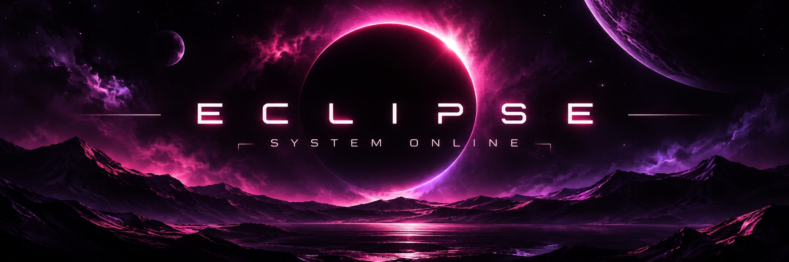
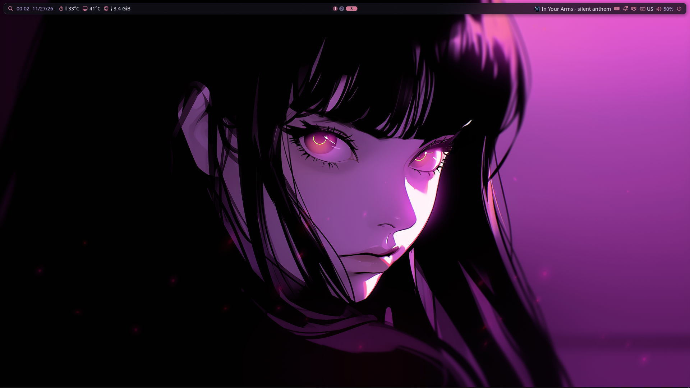
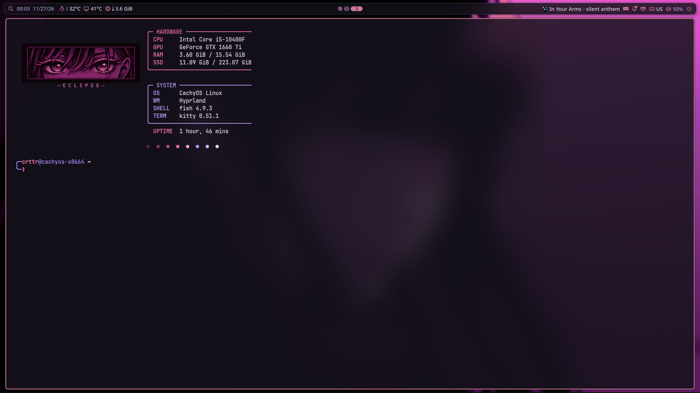
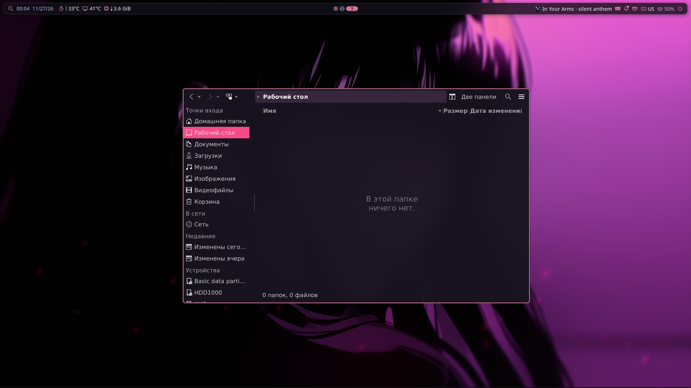
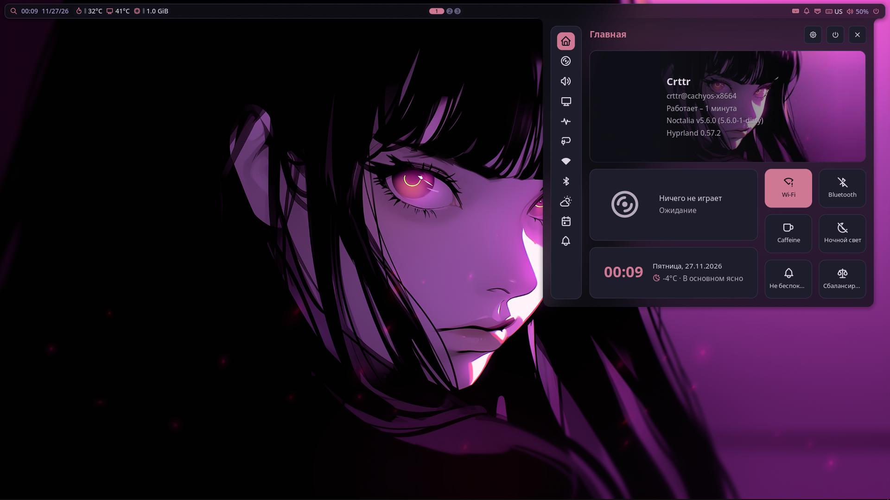
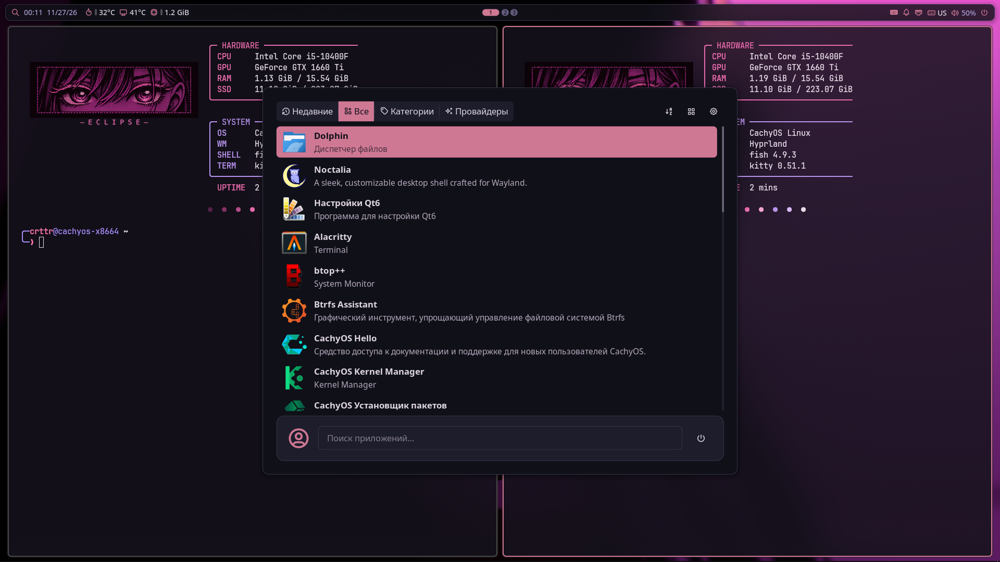
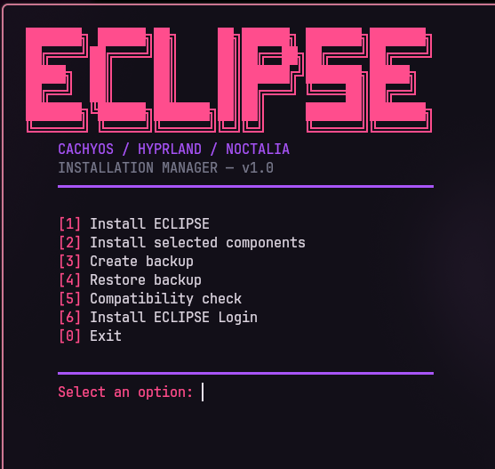

<div align="center">



### A dark, immersive Linux desktop experience.


[Overview](#overview) • [Screenshots](#screenshots) • [Installation](#installation) • [Releases](https://github.com/Crttr/ECLIPSE/releases)

</div>

---

## Overview

**ECLIPSE** is a custom desktop configuration for CachyOS, built around Hyprland and Noctalia.

A unified dark aesthetic combining deep blacks, neon pink and violet accents, custom animations and a personalized desktop experience.

## Screenshots

### Desktop



### Terminal



### File Manager



### Noctalia Shell



### Multitasking



### Interactive Installer



### Animated Login Screen


Custom greetd + Tuigreet login screen featuring:

- Animated DOOM fire effect
- ECLIPSE pink and purple color palette
- SYSTEM ONLINE greeting
- Real-time clock
- Minimalistic authentication interface
- UWSM session integration

## Features

- Customized Hyprland Lua configuration
- Noctalia Shell integration
- Unified dark pink and purple aesthetic
- Custom animations and window decorations
- Kitty, Fish and Starship configuration
- Custom Fastfetch and Btop appearance
- Kvantum, Qt and GTK integration
- Customized Dolphin file manager
- Custom cursors and wallpapers
- Animated Tuigreet login screen
- Interactive modular installer
- Backup and restore utilities
- Compatibility checker

## Installation

Clone the repository:

```bash
git clone https://github.com/Crttr/ECLIPSE.git
cd ECLIPSE
bash install.sh
```

Alternatively, use the archive from the Releases page.

Run the compatibility check before installation.

## Installer

```text
[1] Install ECLIPSE
[2] Install selected components
[3] Create backup
[4] Restore backup
[5] Compatibility check
[6] Install ECLIPSE Login
[0] Exit
```

## Project Structure

```text
ECLIPSE/
├── assets/
│   ├── branding/
│   ├── screenshots/
│   └── wallpapers/
├── dotfiles/
├── packages/
├── scripts/
├── system/
├── install.sh
└── README.md
```

## Requirements

- CachyOS
- Hyprland with Lua configuration support
- Noctalia Shell
- Bash
- UWSM
- Required applications and themes

Dependencies must be installed separately.

## Safety

- Do not run the main installer as root.
- Back up your existing configuration before installation.
- Restore merges saved files and does not remove newly created files.
- The optional login module modifies /etc/greetd.
- Hardware-specific settings may require manual adjustment.

## Release Status

ECLIPSE v1.0 Preview

Installer syntax and menu navigation have been tested on the reference system. Clean-system installation and complete rollback have not yet been validated.

## Credits

Developed by **Crttr**.

Third-party software, icons, cursors and artwork belong to their respective authors. Redistribution rights must be verified before public distribution.

---

<div align="center">

### E C L I P S E

**S Y S T E M  O N L I N E**

Developed by Crttr

</div>
